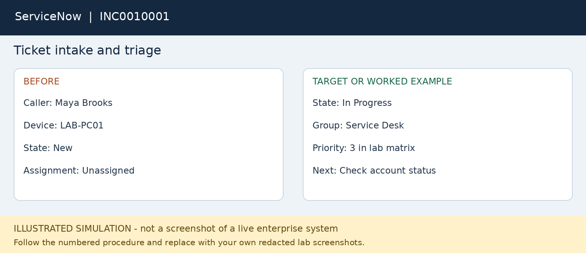

# Enterprise Help Desk Simulation Project
**Cornel Davis | Entry level IT support portfolio**

A training project covering ticket triage, account support, cloud identity, application access, device management and remote support.

> Status: prepared simulation and worked examples. The workflows have not been executed in a live ServiceNow, AD, Microsoft or Okta environment for this repository. PNGs are original illustrated workflow snapshots, not vendor screenshots or proof of hands-on completion. All users, tickets, findings and outcomes are fictional. Record actual execution separately in your local evidence folder.

## Tools covered
ServiceNow ITSM; Windows Server Active Directory and ADUC; Windows 11 Pro or Enterprise; Microsoft Entra ID; Microsoft 365 admin center; Microsoft Intune; Quick Assist (or separately licensed Intune Remote Help); Okta. PowerShell and Event Viewer support diagnostics.

[Download the complete project ZIP](Cornel_Davis_Help_Desk_Simulation.zip) · [Read the PDF guide](Help_Desk_Simulation_Project.pdf)

## Start here
1. Read `Help_Desk_Simulation_Project.pdf` or the editable Word guide.
2. Follow setup in the guide. Use an isolated local lab and separately authorized cloud test tenants.
3. Start with ServiceNow and AD, then complete cloud modules only where access and licenses permit.
4. Work through the eight cases in the `Ticket_01.md` through `Ticket_08.md` files. Record observed findings instead of copying fictional outcomes.
5. Capture real screenshots using the checklist in `Screenshot_Checklist.md` and update the completion log.

## Scope
The local AD domain and cloud tenants are separate exercises. No hybrid synchronization, federation or production integration is claimed. Okta is an alternative identity exercise, not a required connection to Entra. A ServiceNow PDI supplies ticket practice; availability and installed features vary. Microsoft and Okta modules require appropriate test access, roles and applicable licenses; no trial or free tenant is guaranteed.

## Cases
- [INC0010001 — Ticket intake and triage](Ticket_01.md)
- [INC0010002 — Password reset and account unlock](Ticket_02.md)
- [INC0010003 — MFA recovery for a replaced phone](Ticket_03.md)
- [REQ0010004 — Missing application license](Ticket_04.md)
- [INC0010005 — Managed application installation failure](Ticket_05.md)
- [INC0010006 — Consent based remote troubleshooting](Ticket_06.md)
- [REQ0010007 — Single sign on application access request](Ticket_07.md)
- [INC0010008 — Escalation for repeated account lockouts](Ticket_08.md)

## Portfolio use
Until executed: “Developed an enterprise help desk simulation documenting support workflows for ServiceNow, AD, Entra ID, Microsoft 365, Intune and Okta.” After lab completion, replace this with factual hands-on bullets supported by your evidence. Do not claim professional employment, a deployed integration, production support or resolution metrics from these examples.

## Project contents
- Step-by-step Word and PDF guide
- Eight fictional support case walkthroughs
- Eight clearly labeled illustrated snapshots
- Three knowledge base procedures
- Ticket template and execution log
- Screenshot checklist and official reference links

## Visual preview

The downloadable ZIP retains the organized ticket, knowledge-base, snapshot and evidence folders. Files are also available individually here for recruiter review.
