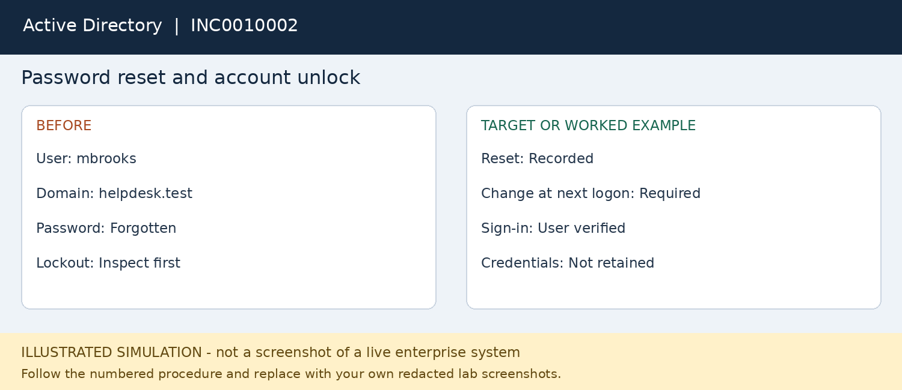

# INC0010002 — Password reset and account unlock

**Platform:** Active Directory

**Status:** fictional worked example; not executed.

## User report
Maya reports a forgotten domain password. Treat lockout and forgotten password as separate checks.

## Where to work
Active Directory Users and Computers > lab OU > user.

## Procedure
1. Verify the test user through the fictional approved callback process; document verification, not secret answers.
2. Open dsa.msc using the delegated lab support account. Locate mbrooks in the HelpDeskLab organizational unit.
3. Confirm the account identity and inspect Account properties. Unlock only if the account is locked.
4. For the forgotten-password scenario, right-click the test user and choose Reset Password.
5. Set a unique temporary lab password and require a password change at next logon. Never put it in tickets or screenshots.
6. Have the user sign in on the domain-connected client and change the password privately.
7. If repeated lockouts continue, investigate saved credentials and map the source before repeated resets.

## Workflow snapshot

## Validation
Test user can sign in with the new password and no unnecessary access changes.

## Escalation
Persistent lockouts or an unexpected account change go to the identity team.

## Screenshots to capture in your lab
Capture the account location, reset options without credentials, and successful test sign-in.

## Technician record
- Actual execution date: Not executed
- Observed findings: To be recorded
- Actions taken: To be recorded
- Validation evidence: To be recorded
- Final status: Not executed
