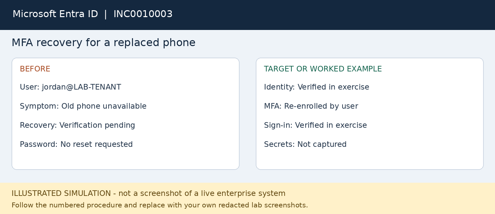

# INC0010003 — MFA recovery for a replaced phone

**Platform:** Microsoft Entra ID

**Status:** fictional worked example; not executed.

## User report
Jordan Ellis has a replacement phone and cannot complete MFA in a separate cloud lab identity.

## Where to work
Entra admin center > Entra ID > Users > user > Authentication methods.

## Procedure
1. Verify Jordan through the approved identity-recovery process; do not accept an unsolicited MFA prompt as verification.
2. Use a delegated Authentication Administrator for an ordinary test user; do not use the tenant owner as the target.
3. Check sign-in failure details and determine whether the factor is unavailable rather than the password being wrong.
4. Review the user authentication methods and follow the tenant recovery procedure.
5. Where approved, select Require re-register MFA. Explain that this removes certain existing methods and forces setup again.
6. Use an approved bootstrap method such as a Temporary Access Pass only if enabled and authorized; do not bypass tenant policy.
7. Have the user register an allowed method, complete a new sign-in and confirm the result in sign-in logs.

## Workflow snapshot

## Validation
User completes MFA with the new allowed method; record timestamps and relevant error details.

## Escalation
Suspicious activity or inability to verify identity requires identity/security escalation.

## Screenshots to capture in your lab
Capture method status and sign-in outcome, never QR codes, access passes or recovery secrets.

## Technician record
- Actual execution date: Not executed
- Observed findings: To be recorded
- Actions taken: To be recorded
- Validation evidence: To be recorded
- Final status: Not executed
