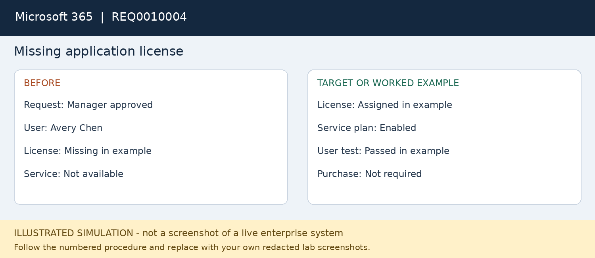

# REQ0010004 — Missing application license

**Platform:** Microsoft 365

**Status:** fictional worked example; not executed.

## User report
Avery Chen is approved for Microsoft 365 but cannot open the required service.

## Where to work
Microsoft 365 admin center > Users > Active users > user > Licenses and apps.

## Procedure
1. Open a service request and record the manager approval and requested application.
2. Verify the target cloud test account, permitted usage location and license availability.
3. Inspect Licenses and apps and distinguish an unassigned license from a disabled service plan.
4. Use an authorized User Administrator or License Administrator to assign an available approved license.
5. Enable only the approved services and save; do not buy subscriptions or add privileged roles.
6. Allow provisioning to complete, then ask the user to sign out and sign back in privately.
7. Validate the licensed service opens; record any remaining provisioning error and escalate if needed.

## Workflow snapshot

## Validation
The approved service opens and the assignment is visible in the admin center.

## Escalation
No available license, billing changes or continued provisioning failure goes to the M365 administrator.

## Screenshots to capture in your lab
Capture approval, license assignment without sensitive identifiers, and the user service test.

## Technician record
- Actual execution date: Not executed
- Observed findings: To be recorded
- Actions taken: To be recorded
- Validation evidence: To be recorded
- Final status: Not executed
