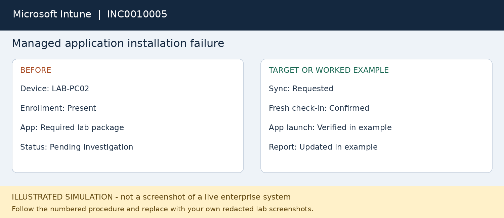

# INC0010005 — Managed application installation failure

**Platform:** Microsoft Intune

**Status:** fictional worked example; not executed.

## User report
LAB-PC02 is enrolled but an approved required application has not installed.

## Where to work
Intune admin center > Troubleshooting and support; select user and device.

## Procedure
1. Record the device name, application, reported error and last successful use.
2. Check enrollment, last check-in and internet connectivity before changing anything.
3. Review the app installation status and capture the actual error code; do not guess a root cause.
4. Check assignment group, requirements and detection results with the endpoint team if access is limited.
5. For this worked example, connectivity interrupted a check-in. Restore connectivity and trigger an authorized device sync.
6. Retry the installation as applicable and wait for a fresh status; a queued sync is not proof of repair.
7. Have the user launch the app and compare the device result with Intune reporting before resolving.

## Workflow snapshot

## Validation
Application launches and updated device/app status supports the result.

## Escalation
Unclear installation code, missing deployment permissions or fleet-wide failure goes to endpoint management.

## Screenshots to capture in your lab
Capture original status/error, sync request, fresh status and successful app launch.

## Technician record
- Actual execution date: Not executed
- Observed findings: To be recorded
- Actions taken: To be recorded
- Validation evidence: To be recorded
- Final status: Not executed
