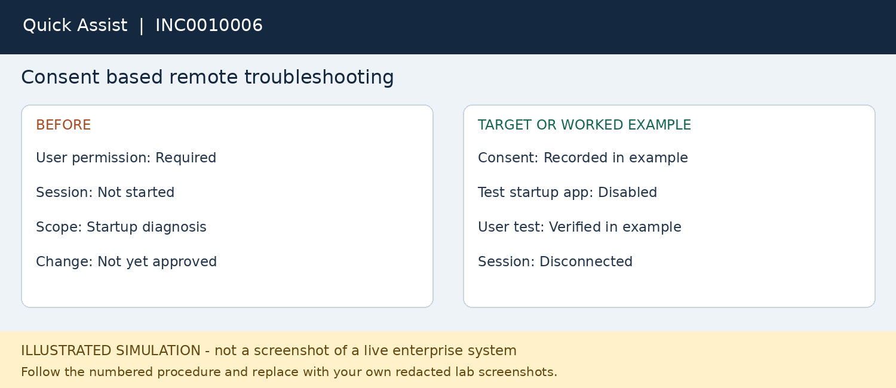

# INC0010006 — Consent based remote troubleshooting

**Platform:** Quick Assist

**Status:** fictional worked example; not executed.

## User report
Taylor Reed needs help diagnosing slow startup on a second Windows lab device.

## Where to work
Quick Assist on both devices; helper and user follow the consent prompts.

## Procedure
1. Verify the caller and link the remote session to the incident. Ask permission before sharing or taking control.
2. Open Quick Assist on both endpoints. The helper follows the sign-in prompts and shares the session code privately.
3. The user enters the code and approves screen sharing; request control only if needed and wait for approval.
4. Ask the user to close private content. Review Task Manager startup applications and current resource use.
5. In this lab disable only a preselected nonessential test startup application; record its original setting.
6. Have the user restart when convenient and compare the observed startup behavior; restore the setting if no benefit.
7. End the session and confirm it is disconnected. Record the outcome without recording the session code.

## Workflow snapshot

## Validation
The user confirms the test result and the remote connection is ended.

## Escalation
Managed security agents and policy-controlled startup items require endpoint-team review.

## Screenshots to capture in your lab
Capture consent status without the code, the changed test setting and the ended session.

## Technician record
- Actual execution date: Not executed
- Observed findings: To be recorded
- Actions taken: To be recorded
- Validation evidence: To be recorded
- Final status: Not executed
