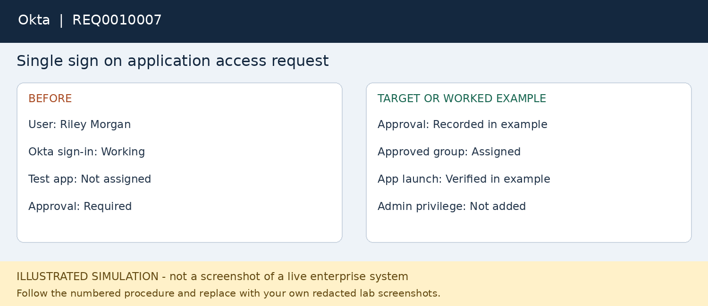

# REQ0010007 — Single sign on application access request

**Platform:** Okta

**Status:** fictional worked example; not executed.

## User report
Riley Morgan can sign in to Okta but cannot see an approved test application.

## Where to work
Okta Admin Console > Directory > People > user; review groups and applications.

## Procedure
1. Record which application is missing and obtain fictional application-owner approval.
2. Confirm that the user is active and can sign in; a missing app tile is not automatically an MFA issue.
3. Review current assignments and membership of the approved lab access group.
4. Using a role permitted for the task, add the user to the correct lab group only after approval.
5. If assignment is direct, follow the application-owner procedure rather than creating duplicate access paths.
6. Ask the user to start a fresh session and launch the test application. Check assignment and any available relevant events.
7. If SSO succeeds but the app denies authorization, escalate to the application owner with the error and timestamp.

## Workflow snapshot

## Validation
The authorized application opens with the expected non-admin access.

## Escalation
Federation errors or missing downstream application entitlements require application/identity escalation.

## Screenshots to capture in your lab
Capture the approval, group or app assignment and successful non-sensitive app landing page.

## Technician record
- Actual execution date: Not executed
- Observed findings: To be recorded
- Actions taken: To be recorded
- Validation evidence: To be recorded
- Final status: Not executed
