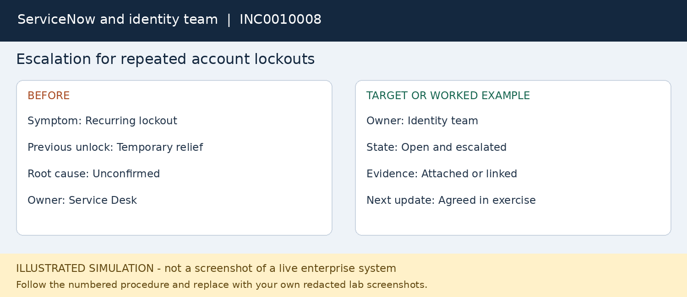

# INC0010008 — Escalation for repeated account lockouts

**Platform:** ServiceNow and identity team

**Status:** fictional worked example; not executed.

## User report
Maya locks out again after a previous unlock. The source has not been established.

## Where to work
ServiceNow incident > Work notes > Assignment group and escalation procedure.

## Procedure
1. Reopen the linked incident or create a linked recurrence according to the lab process.
2. Record the recurrence time, affected device, error and whether the user recently changed a password.
3. Check safe client-side possibilities such as an old mapped-drive credential with user permission; do not delete all credentials blindly.
4. Gather the previous reset timestamp, reproduction steps and available event references without copying tokens or passwords.
5. Route to the identity team when domain event correlation or privileged investigation exceeds service desk access.
6. Use Pending with a clear reason if supported by local workflow, or keep In Progress with explicit new ownership.
7. Tell the user the issue has been escalated and when to expect the next update. Keep the case open until evidence supports resolution.

## Workflow snapshot

## Validation
A complete handoff is achieved; this case is intentionally not marked resolved.

## Escalation
Security indicators go to security operations; do not assert an incident without supporting evidence.

## Screenshots to capture in your lab
Capture the recurrence notes, new assignment and user update. Leave the result open until investigated.

## Technician record
- Actual execution date: Not executed
- Observed findings: To be recorded
- Actions taken: To be recorded
- Validation evidence: To be recorded
- Final status: Not executed
